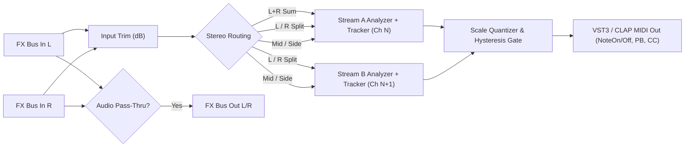

# Architecture & DSP Design — `mtz-realtime-midi`

## 1. Real-Time Audio Thread Constraints

`mtz-realtime-midi` is engineered for strict real-time audio safety (`nih_plug`'s `assert_process_allocs` feature is enabled):
- All ring buffers (`[f32; 2048]`), Hann windows, FFT real/imaginary work buffers, magnitude/residual spectra, YIN difference tables, and note state machines (`[ActiveNoteSlot; 128]`) are inline fixed-size arrays allocated once when the plugin is instantiated.
- Outgoing MIDI events are collected per audio block into a fixed-capacity stack/struct buffer (`MidiEventBuffer` with `MAX_EVENTS_PER_BLOCK = 256`) and emitted via `ProcessContext::send_event`.
- GUI telemetry uses atomic primitives (`AtomicU32`, `AtomicU8`, `AtomicUsize`, `AtomicBool`) and non-blocking `parking_lot::Mutex::try_lock()` for the 88-key keyboard & 96-frame pitch trail snapshot.

---

## 2. Signal Flow Pipeline

---

## 3. Latency vs. Frequency Resolution ("Realish Time")

Converting arbitrary audio to MIDI faces the classic Gabor time-frequency uncertainty tradeoff:
- At `48 kHz`, a `1024`-sample window spans **`21.3 ms`**, while a `2048`-sample window spans **`42.7 ms`**.
- Rather than waiting a full window between updates, `StreamAnalyzer` advances in **overlapping hops of `256` samples (`5.3 ms` at `48 kHz`)**:
  - Attack RMS is weighted toward the most recent `256`-sample hop so transient onset detection responds within ~5 ms.
  - In **Monophonic (YIN)** mode with the `1024` window and `Stability Hops = 1`, total pitch-to-MIDI reaction time is typically **10–21 ms**.
  - In **Polyphonic FX Bus (Harmonic Sieve)** mode with the `2048` window, parabolic log-magnitude interpolation achieves sub-bin frequency precision while resolving chords down to low bass registers.
